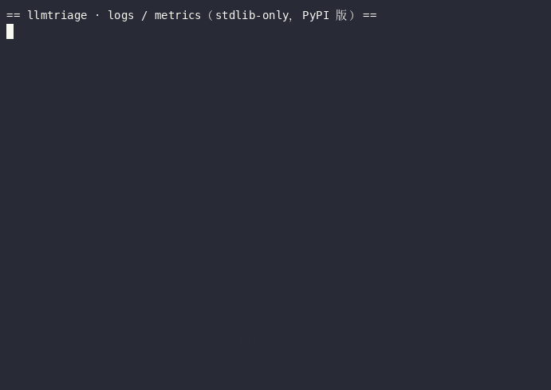

# llmtriage

**Triage a broken LLM inference deployment in one command.** Readiness, *is the GPU actually doing the work*, *is that error message a fake lead*, and *will this batch finish before the deadline* — with an evidence line for every verdict.

[](https://github.com/aidless/llmtriage/actions/workflows/ci.yml)

> ⬇️ Quickstart 实录（本机录制，非模拟输出）:


[](pyproject.toml)
[](LICENSE)

> Status: **0.1.1, early**. Works on a single host against an OpenAI-compatible endpoint. No Kubernetes, no Prometheus, no cluster mode — see [Scope and non-goals](#scope-and-non-goals).

**Verified now:** `pytest -q` → **57 passed** · `llmtriage logs --file examples/vllm_fake_lead.log`
resolves the parent's `Failed core proc(s): {}` to the child process's
`ImportError: libflash_attn_2_cuda.so` instead of following the fake lead.

---

## Why this exists

Benchmarking tools answer *how fast is it*. GPU monitors answer *what is the card doing*. Neither answers the question you actually have at 2 a.m. when a deployment will not serve:

**"Is this thing broken, and if so, which layer?"**

Three failure patterns kept costing hours on real deployments, and each one is invisible to a benchmark or a monitor:

| Pattern | What you see | What is really happening |
|---|---|---|
| **Fake lead** | `Engine core initialization failed. Failed core proc(s): {}` | The real exception is in the **child process** stderr (`EngineCore_DP0 pid=…`). Following the parent's message sends you down the wrong path. |
| **Silent CPU fallback** | Throughput is terrible (e.g. 4.32 tok/s) | Per-GPU memory is near zero: tokens are being generated on the **CPU**. Cutting the token budget will not help; fixing layer placement will. |
| **Budget overrun** | The run finishes *after* the deadline, with nothing persisted | tokens ÷ tok/s × requests already exceeds the wall clock. You needed that arithmetic **before** launching. |

`llmtriage` makes those three checks runnable, and forces every verdict to carry evidence and a three-state label.

## Install

```bash
git clone https://github.com/aidless/llmtriage.git && cd llmtriage
pip install -e ".[dev]"      # from a source clone, with pytest
```

> Not on PyPI yet — the install above is the supported route. The dists are
> verified before release: `twine check` passes, the wheel installs into a
> clean venv, and the **sdist proves itself** — `pip install -e ".[dev]" && pytest` passes
> from the extracted sdist, examples included.

## Usage

```bash
# 1. Is the endpoint up, and what does it serve?
llmtriage probe --base-url http://127.0.0.1:8000

# 2. Same, plus a single-request throughput measurement (feeds the budget check)
llmtriage probe --base-url http://127.0.0.1:8000 --measure --model qwen3_4b

# 3. Are the GPUs actually doing the work?
llmtriage gpu

# 4. Is this error message a fake lead?
llmtriage logs --file examples/vllm_fake_lead.log

# 5. Will this batch finish before the deadline?
llmtriage budget --tokens 12000 --tok-per-s 4.32 --deadline 7200

# 6. Is the service queueing or thrashing its KV cache? (reads /metrics, no writes)
llmtriage metrics --url http://127.0.0.1:8000
llmtriage metrics --file metrics.txt        # offline: paste a saved capture

# 7. Throughput means nothing without SLOs: what fraction of requests actually met TTFT+TPOT?
llmtriage slo --csv samples.csv --ttft-slo 1.0 --tpot-slo 0.1

# 8. Given the evidence collected above, what is the most likely cause and what do I check next?
llmtriage explain --log vllm.log --metrics metrics.txt

# Everything at once
llmtriage triage --base-url http://127.0.0.1:8000 --log vllm.log \
                 --tokens 12000 --tok-per-s 4.32 --deadline 4500 --requests 2 \
                 --explain --out triage.md

# Turn that report into a postmortem a reviewer will accept
llmtriage postmortem --from triage.json --title "vLLM 起服失败，整批任务零产出" \
                     --root-cause-state UNRESOLVED \
                     --action "屏蔽残缺包" --verify "重启后 /v1/models 返回 200" \
                     --out postmortem.md
```

> Shell note: the exit codes are real, so `llmtriage logs ... && next-step` **stops** when a
> problem is found (exit 1). Chain with `;` or `|| true` in scripts where that is intended.

### Real output (no hand-written examples)

```console
$ llmtriage budget --tokens 12000 --tok-per-s 4.32 --deadline 4500 --requests 2 --json
{
  "findings": [{
    "kind": "budget",
    "verdict": "NO_GO",
    "state": "OBSERVED",
    "evidence": "12000 tok ÷ 4.32 tok/s = 2777.8s/请求；×2 请求 = 5555.6s；含 20% 余量需 6666.7s，截止 4500.0s",
    "detail": { "suggestion": "要么降 token 量到 8100 以内，要么把 deadline 提到 6667s 以上" }
  }],
  "verdict": "NO_GO"
}
# exit 1
```

```console
$ llmtriage logs --file examples/vllm_fake_lead.log
## logs → `FAKE_LEAD_SUBPROCESS_ERROR`（OBSERVED）

证据：
(EngineCore_DP0 pid=48213) ImportError: libflash_attn_2_cuda.so: cannot open shared object file
- **next_step**：以子进程异常为准去查（缺包/驱动/权限），不要照父进程提示去查
# exit 1
```

```console
$ llmtriage metrics --file examples/vllm_metrics_saturated.txt
# 指标快照

**总体结论：`SATURATED`（证据状态：OBSERVED）** —— 1 项异常（metrics）

## metrics → `SATURATED`（OBSERVED）

证据：

```
vllm:num_requests_running{model_name="qwen3_4b"} 8.0 | vllm:num_requests_waiting{model_name="qwen3_4b"} 47.0 | vllm:gpu_cache_usage_perc{model_name="qwen3_4b"} 0.98 | vllm:num_preemptions_total{model_name="qwen3_4b"} 312.0 | ...
```
- **kv_usage**：0.98
- **waiting**：47.0
- **preemptions_total**：312.0
- **prefix_hit_rate**：0.1333
- **hint**：排队 47 且 KV 占用 98%：先降并发/扩副本，再谈压测数字
# exit 1
```

```console
$ llmtriage slo --csv examples/slo_samples.csv --ttft-slo 1.0 --tpot-slo 0.1
## slo → `DEGRADED`（OBSERVED）

n=8 goodput=0.750 目标=0.990 超 TTFT 2 条 / 超 TPOT 0 条（SLO 1.000s / 0.100s）
- **binding**：ttft
- **ttft_p50**：0.51 · **ttft_p95**：2.4 · **tpot_p50**：0.023
- **hint**：超的是 TTFT：瓶颈多在 prefill / 输入长度 / 排队，不在 decode
# exit 1
```

```console
$ llmtriage explain --log examples/vllm_fake_lead.log --metrics examples/vllm_metrics_saturated.txt
## 下一步：待验证假设（按优先级）

### 1. [HIGH] 引擎子进程崩溃，父进程日志里的报错是假线索（依赖包残缺或版本不匹配最常见）

- 依据：logs
- 下一句检查：`读子进程日志尾部：grep -n 'pid=' 启动日志 | tail -50；再单独 import 可疑包 …`

### 2. [HIGH] 请求排队且 KV 缓存打满：吞吐被显存容量与并发上限卡住（排队 47 / 占用 98%）

- 依据：metrics
- 下一句检查：`① 降 --max-num-seqs 观察 waiting 是否回落 ② 扩副本 ③ 开 --enable-prefix-caching …`
# exit 0
```

## Postmortem reports

`llmtriage postmortem` turns findings into the document the JD-shaped work actually ends with:
*"评估报告、优化建议和问题复盘"*. It is opinionated in one direction only — **it will not let an
unknown root cause read as a fix**:

- root cause is a **three-state declaration**: `CONFIRMED` (evidence closes the loop) /
  `SUSPECTED` (clue, not closed) / `UNRESOLVED` (do not know). Selecting `UNRESOLVED` makes the
  report say *"根因未确定：以下处置只用于限制影响，不是根因修复"*.
- with no verification evidence, the 验证 section prints **未验证** and *"在补充验证前，不得把该事件
  标记为已解决"*. The string `已修复` never appears in generated output — whether it is fixed is
  answered by the verification section, not by wording.
- every finding's raw `evidence` lines are copied verbatim into appendix 证据清单.

Two generated examples ship in the repo, both produced by the CLI (not hand-written):

| File | Shape |
|---|---|
| [`examples/postmortem-example.md`](examples/postmortem-example.md) | `CONFIRMED`, 4 timeline entries, verification filled |
| [`examples/postmortem-unresolved-example.md`](examples/postmortem-unresolved-example.md) | `UNRESOLVED`, no verification → flagged, open items enumerated |
| [`examples/vllm_metrics_saturated.txt`](examples/vllm_metrics_saturated.txt) | a real vLLM `/metrics` capture (labels, HELP/TYPE lines) that trips `SATURATED` |
| [`examples/slo_samples.csv`](examples/slo_samples.csv) | 8 `ttft_s,tpot_s` samples where 2 misses make goodput 0.75 |

## What is verified, and on what

| Claim | Evidence |
|---|---|
| ROCm parsing works on real hardware | one run on an AMD Radeon PRO W7900 instance: `rocm-smi 4.0.0` CSV → 49136 MB VRAM, 27 MB used, `DEGRADED`, exit 1. Raw capture kept as [`tests/fixtures/rocm_smi_w7900_2026-11-01.csv`](tests/fixtures/rocm_smi_w7900_2026-11-01.csv); write-up in [`docs/evidence-rocm-w7900-2026-11-01.md`](docs/evidence-rocm-w7900-2026-11-01.md) |
| NVIDIA parsing | `nvidia-smi` CSV, covered by unit tests only — no hardware run recorded yet |
| Fake-lead detection | captured from a real failed vLLM start (`examples/vllm_fake_lead.log`), not hand-written |
| Not verified | the *in_use* path on AMD (needs a served model under load), multi-card, MIG, older `rocm-smi` versions |

## The two contracts

### 1. Exit codes (machine-usable in CI or a runbook)

| Code | Meaning |
|---|---|
| `0` | All checks passed |
| `1` | A problem was found (`NO_GO` / `DEGRADED` / `NOT_READY` / `FAKE_LEAD_SUBPROCESS_ERROR` / `GENUINE_PARENT_ERROR`) |
| `2` | Usage error |
| `3` | **Insufficient data (`UNKNOWN`)** — never silently treated as success |

### 2. Three-state evidence

Every finding is labelled:

- `OBSERVED` — measured in this run (the command and its raw output are in `evidence`)
- `INFERRED` — derived from measurements, not directly observed
- `UNKNOWN` — not enough data. **A clean log is `NO_ERROR_FOUND`, not "healthy"**, and a missing `nvidia-smi` is `UNKNOWN`, not "0 GPUs".

This is the point of the tool: the expensive failures are the ones that *look* fine.

## Scope and non-goals

It is deliberately **not**:

- a benchmark suite → use [inference-perf](https://github.com/kubernetes-sigs/inference-perf) (TTFT/TPOT/ITL/goodput, saturation sweeps) or [llmperf](https://github.com/ray-project/llmperf)
- a GPU monitor / exporter → use [nvitop](https://github.com/XuehaiPan/nvitop), [nvtop](https://github.com/Syllo/nvtop), [DCGM exporter](https://github.com/NVIDIA/dcgm-exporter)
- a capacity simulator → it does one piece of arithmetic, transparently, on numbers you supply

Known limits, stated rather than hidden:

- `gpu` tries `nvidia-smi` first, then `rocm-smi`. ROCm parsing maps columns **by name, not by position** (column order varies across `rocm-smi` versions); an unrecognised schema returns `UNKNOWN` instead of a guessed number. `amd-smi` is not yet wired up.
- **ROCm real-hardware evidence is one run, one card, one `rocm-smi` version.** The W7900/gfx1100 capture (2026-11-01, `rocm-smi 4.0.0`) is recorded as a fixture + write-up (see "What is verified" above), but it is a single snapshot: the *in-use* path, multi-card, MIG, and other `rocm-smi` versions remain unverified and return `UNKNOWN` rather than a guess.
- `probe --measure` is **single-request (batch=1)** throughput. It is an input to a budget calculation, **not** a server throughput ceiling.
- `logs` matches a small, explicit pattern set (vLLM / SGLang engine-core style failures). Unknown stacks come back `UNKNOWN` rather than a guess.

## What this proves — and what it does not

**Proves (within the evidence in this repo):**

- A single command can tell you *which layer* a broken LLM deployment fails at:
  GPU real usage (NVIDIA + ROCm, mapped by column name), fake-lead vs. genuine
  error classification, readiness, and runtime budget arithmetic.
- The three-state evidence contract is enforced, not claimed: a clean log is
  `NO_ERROR_FOUND`, not "healthy"; a missing `nvidia-smi` is `UNKNOWN`, not
  "0 GPUs"; exit code `3` is reserved for insufficient data so CI never
  mistakes "couldn't tell" for "all good".
- ROCm parsing works on **real** hardware (AMD Radeon PRO W7900 / gfx1100,
  `rocm-smi 4.0.0`, captured 2026-11-01 and stored as a fixture + write-up),
  and survives column reordering (a unit counter-proof).

**Does not prove (honest boundary):**

- **No benchmark or capacity claim.** `probe --measure` is single-request
  throughput, an input to a budget calculation, not a server ceiling.
- **No multi-model / multi-card / MIG evidence.** The single W7900 snapshot is
  one run, one card, one `rocm-smi` version. The `in_use` path on AMD,
  multi-card, MIG, and other `rocm-smi` versions are unverified.
- **No NVIDIA real-hardware run.** NVIDIA parsing is covered by unit tests only;
  no physical `nvidia-smi` capture is in the repo.
- **No causal diagnosis.** The tool reports *what* is wrong at which layer; it
  does not explain *why* a model degraded, and it does not fix anything.
- **No monitoring or dashboards.** It is a point-in-time triage, not a metrics
  exporter.

## Reproduce the numbers

Everything above is re-derivable from the repo alone, no GPU needed:

```bash
python -m pytest -q        # 31 pass — parsing, budget, log triage, exit codes
```

The ROCm claim traces to
`tests/fixtures/rocm_smi_w7900_2026-11-01.csv` +
`docs/evidence-rocm-w7900-2026-11-01.md` (the raw capture and its write-up),
and the fake-lead claim to `examples/vllm_fake_lead.log` (a real failed vLLM
start, not a hand-written example).

## Prior art and how this differs

Surveyed 2026-10-31 via the GitHub API; star counts move, so treat them as a timestamp:

| Project | ★ | What it solves | What it does not |
|---|---|---|---|
| [vllm](https://github.com/vllm-project/vllm) / [sglang](https://github.com/sgl-project/sglang) | 96k / 38k | serving engine | no triage verdicts |
| [nvitop](https://github.com/XuehaiPan/nvitop) / [nvtop](https://github.com/Syllo/nvtop) | 7.2k / 11k | see GPU + processes | no inference-layer reasoning |
| [dcgm-exporter](https://github.com/NVIDIA/dcgm-exporter) | 1.9k | metrics for Prometheus | needs a metrics stack; no verdicts |
| [inference-perf](https://github.com/kubernetes-sigs/inference-perf) / [llmperf](https://github.com/ray-project/llmperf) | 266 / 1.1k | benchmark latency & throughput | assumes the deployment already works |
| **llmtriage** | — | *is the deployment broken, and at which layer* | no benchmarking, no dashboards |

## Development

```bash
python -m pytest -q      # 57 tests: NVIDIA + ROCm parsing, budget math, log triage (with a                         # negative control), a live OpenAI-stub probe, report schema,
                         # postmortem shape + honesty rules, exit codes
```

Tests are written before the implementation (RED → GREEN). Two of them are counter-proofs rather
than happy paths:

- the log classifier carries a **negative control**: a genuine parent-process traceback must *not*
  be reported as a fake lead;
- the ROCm parser is fed the **same data in a reordered column layout** and must produce identical
  results — that is what makes "map by column name" a claim instead of a comment;
- the postmortem generator is asserted to **contain no `已修复`** when the root cause is unresolved,
  and to print `未验证` when no verification evidence is supplied.

## License

MIT

## 验收标准与复算

本仓的验收判据只有一条：`python3 eval/run_cases.py` 的通过率必须 ≥100%（20/20），且 `make eval` 退出码必须为 0；任何一条 case 失败即判为不合格（`run_cases.py` exit 1），题库本身有问题（缺字段/重复 id/读不了）即 exit 2。

这套题不是"示例数据"，`expr` 题的期望值全部由本仓 API 现算得出（改一行实现就会变红），输入取自本仓的真实抓取：`examples/vllm_fake_lead.log`、`examples/vllm_metrics_saturated.txt`、`examples/slo_samples.csv`、`tests/fixtures/rocm_smi_w7900_2026-11-01.csv`。

| axis | 条数 | 验的是什么 | 真调用的入口 |
|---|---|---|---|
| `budget` | 3 | 预算换算（含 20% 余量）、缺吞吐时拒绝下结论 | `llmtriage.budget.estimate` |
| `logs` | 3 | 父进程假线索 vs 子进程真异常、负对照（父进程自身 traceback 不许报成假线索）、子进程 pid | `llmtriage.logs.analyse` |
| `gpu` | 3 | ROCm VRAM 解析（按列名）、列顺序打乱后结果不变、空 nvidia-smi 必须抛 `ValueError` | `llmtriage.gpu.parse_rocm_smi` / `parse_nvidia_smi` |
| `metrics` | 2 | 真实 `/metrics` 抓取的 SATURATED 判定、prefix_hit_rate | `llmtriage.metrics.snapshot_metrics` |
| `slo` | 3 | 样本条数 n、goodput=0.75、ttft_p95（nearest-rank 不插值） | `llmtriage.slo.parse_samples_csv` / `evaluate_slo` |
| `report` | 2 | 多条 finding 的总体 verdict 取最坏、摘要行原文 | `llmtriage.report.overall` / `_summary_line` |
| `cli` | 2 | 退出码契约（UNKNOWN→3）、`logs` 子命令对真实日志返回 1 | `llmtriage.cli._exit_code` / `main` |
| `postmortem` | 1 | 根因 UNRESOLVED 且无验证证据时，产物里不出现「已修复」 | `llmtriage.postmortem.build_postmortem` |
| `explain` | 1 | 假线索 finding 必须产出 `H-DEP-BROKEN` 假设 | `llmtriage.explain.explain` |

三条命令（从仓库根执行）：

```bash
python3 eval/run_cases.py             # 20/20 cases passed，退出码 0
python3 eval/run_cases.py --selftest  # 19/20（首题期望值被篡改必须变红），退出码 0
python3 eval/run_cases.py --save      # 重建 eval/run-report.json（含 results 与 failed_by_axis）
```

**复算说明**：每题 `verify` 字段本身就是复算代码——它当场执行本仓 API 并与 `expected` 比对，没有第二份"答案文件"可以走偏；`eval/run-report.json` 只是某次运行的落盘快照，随时代码即可重建（`--save`），改实现后重跑它若与文档数字不一致，以 `run_cases.py` 的实跑为准。`make eval` = 本题库 + 既有 `pytest -q`，任一失败即非零退出。

**失败归因**：`run_cases.py` 不只报 pass_rate，失败按 `axis` 汇总并列出 case id，直接指向坏掉的那一层。`--selftest` 的实测输出就是范例：

```
19/20 cases passed
失败归因（按 axis）：
  budget: 1 条 —— budget-no-go
```
